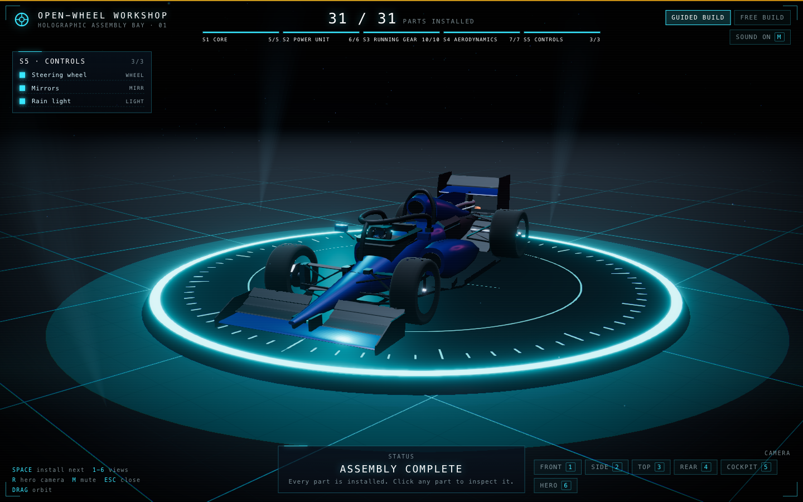
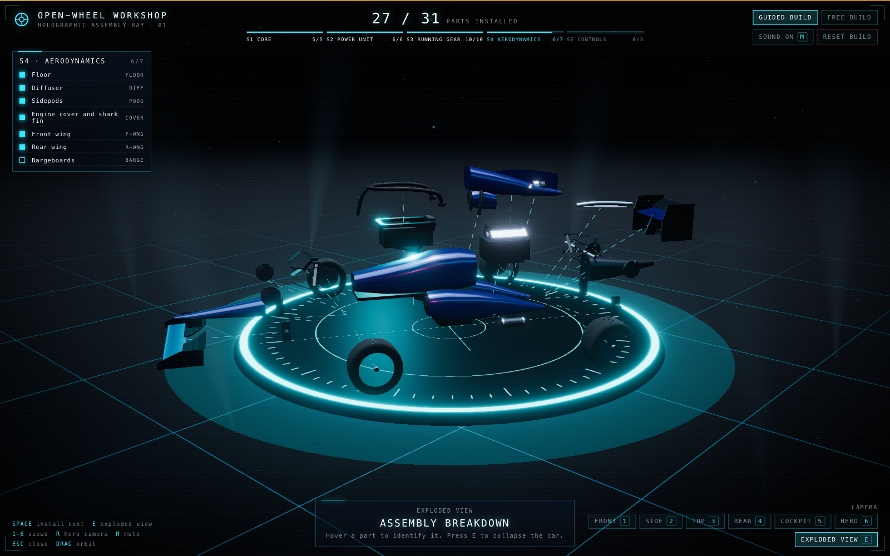
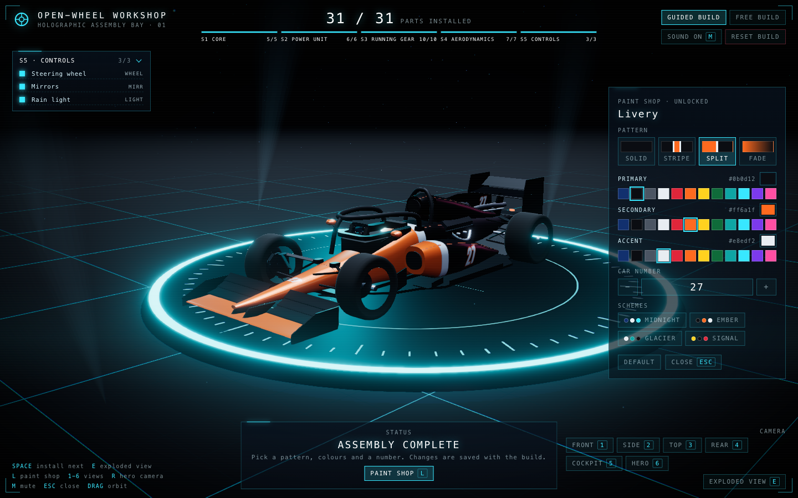
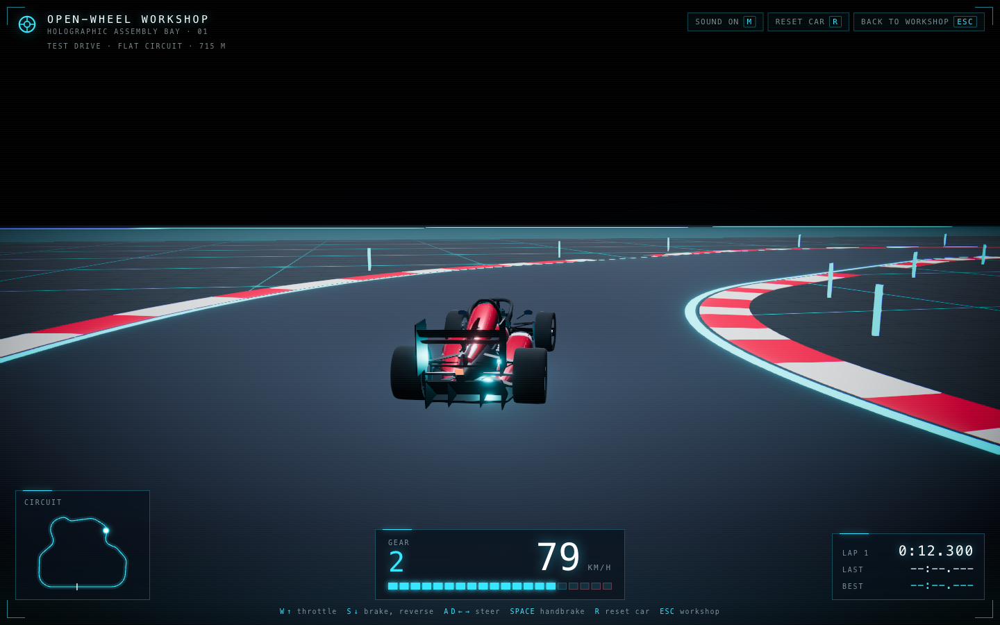
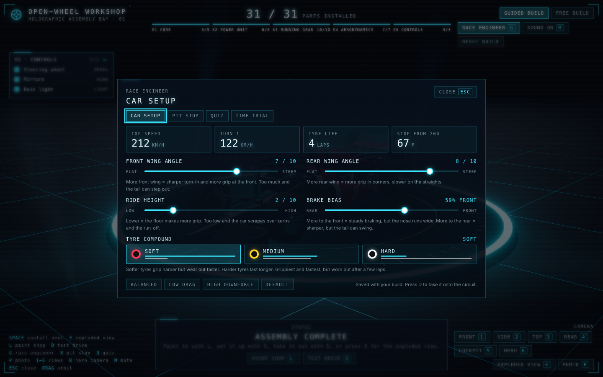
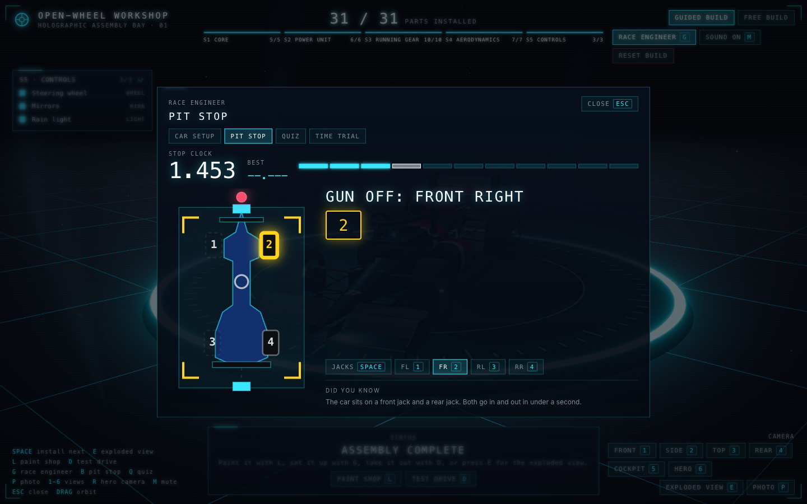
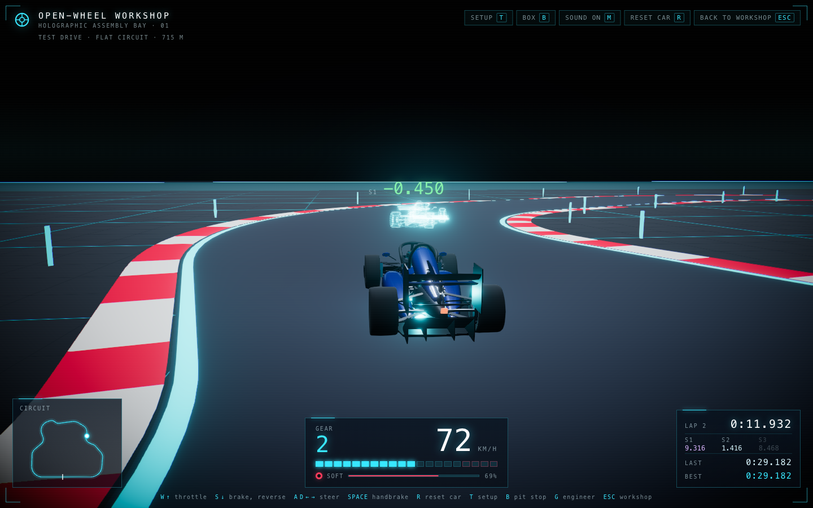

# Open-Wheel Workshop

Build a modern open-wheel race car part by part inside a holographic workshop. Parts float around
the build platform as glowing blue holograms. Click or drag one onto the chassis and it flies into
place, locks in with a flash, and materialises from wireframe into solid carbon and metal. Every part
comes with a short engineering card explaining what it does and how it connects to the rest of the
car. Pull the finished car apart in Exploded View, let the workshop assemble it for you, paint it in
the workshop's paint shop, and come back later: the build and the livery are saved in the browser.
Then put on the race engineer's headset: set the car up, change its tyres against the clock, test
what you have learned, chase your own ghost round the circuit and photograph the result.



## Features

- **Guided and Free Build.** Guided walks the 31 parts in order; Free lets you install anything whose
  dependencies are in place. Wheels need brakes, brakes need uprights, the rear wing needs the engine
  cover and gearbox. A wrong part lunges, bounces back and tells you what is missing.
- **Click, drag or press Space.** Parts fly in along an arc with a magnetic snap, a lock-in flash and a
  servo-and-clunk sound, then materialise with a rising wipe.
- **Inspect and detach.** Click any installed part: the camera frames it, the rest of the car fades to
  wireframe and a card shows its role, two engineering notes and how it connects. Detaching cascades
  to dependent parts.
- **Exploded View.** Press `E` to slide every installed part out along its own vector with a stagger
  by stage, each tethered to its home point. Hover parts to identify them.
- **Assemble All.** Sit back while the workshop installs the remaining parts, moving the camera to a
  new angle for each stage. Stop it with `Esc` or skip to the finished car.
- **Completion moment.** When the last part locks in, shockwaves cross the floor, the platform flares,
  the engine fires up, the camera sweeps the car and the HUD types out SYSTEMS ONLINE.
- **Paint shop.** Unlocked when the car is complete. Pick a pattern (solid, stripe, split, fade),
  three colours, a car number and one of four original schemes. The livery is painted in car space
  from two shared canvas masks, so every painted part updates at once and the number reads correctly
  on the nose, the sidepods and the shark fin from either side.
- **Save and resume.** The installed parts, build mode, sound setting and livery are stored in the
  browser and restored on the next visit. Reset build clears them after a confirmation.
- **Works on a tablet and from the keyboard.** The HUD reflows at 1024 px and 820 px, every action
  is a focusable control with a visible focus ring, the checklist rows install or inspect parts, the
  objective and toasts are live regions, and reduced-motion settings are respected.
- **Procedural everything.** No models, textures, fonts or audio files. Geometry is built from
  primitives, lathes and extrusions; every sound is synthesised with the Web Audio API.
- **Test drive (behind a flag).** With `VITE_ENABLE_TEST_DRIVE=true`, a finished car gets a Drive
  button: a flat night circuit with glowing edges and kerbs, arcade driving on WASD, the arrows or a
  gamepad, a chase camera, lap timing with a minimap, and an engine note that follows the revs.
- **Race engineer.** Press `G`. Car setup with front and rear wing angle, tyre compound, ride height
  and brake bias, each explained in one plain line and each changing what the car does on the
  circuit: more wing means more grip in corners and a lower top speed, softs grip and then fall off a
  cliff, a low floor scrapes over kerbs, and a nose-heavy setup lets the tail step out. The panel
  predicts top speed, turn-one speed, tyre life and stopping distance before a wheel turns.
- **Pit-stop challenge.** Call the car in and hit the prompts in order: jacks up, four wheels off,
  four new tyres on, jacks down, release on the green light. Wrong keys cost half a second. The best
  time is saved; a clean stop under five seconds earns the Pit crew badge. On the track it fits
  fresh tyres.
- **Engineer's quiz.** Eight questions drawn from the info cards (which part does this job, which
  stage is it installed in, how heavy is the halo), each followed by the card's own words. A perfect
  round earns the Race engineer badge.
- **Time trial.** Three sectors with splits against your best lap, a hologram ghost replaying it
  ahead of you, a local top-ten leaderboard filed under a driver tag, and the Hot lap badge for a
  lap under thirty seconds. Laps that leave the track are timed but not counted.
- **Photo mode.** Press `P` in the workshop or on the track: a free camera, depth of field focused on
  the car or at a chosen distance, a turntable, hidden UI, and a PNG download of the frame.













## Who it is for

- People who enjoy motorsport engineering and want to see how a modern single-seater goes together.
- Anyone who wants a tactile, cinematic 3D toy that runs in a browser tab with nothing to install.
- Developers looking for a worked example of React Three Fiber, custom GLSL materials,
  postprocessing, procedural audio and zustand in a strict TypeScript project.

## Stack

| Layer | Choice                                                             |
| ----- | ------------------------------------------------------------------ |
| Build | Vite 8, TypeScript 5.9 in strict mode, ESLint 10, Prettier         |
| UI    | React 19, framer-motion for HUD and panel animation                |
| 3D    | Three.js through @react-three/fiber and @react-three/drei          |
| Post  | @react-three/postprocessing: bloom, vignette, chromatic aberration |
| State | zustand with the persist middleware over localStorage              |
| Audio | Web Audio API, every sound synthesised at runtime                  |

No backend and no external assets. Every part is built from Three.js primitives, lathe and extrude
geometry. The part system can swap any part for a GLB model later by dropping a file into
`public/models` and changing one config entry.

## Run it

Requires Node 20.19 or newer (Node 22.12 or newer also works).

```bash
npm install
npm run dev
```

Open <http://localhost:5173>.

To switch on the test drive, copy `.env.example` to `.env.local` and set `VITE_ENABLE_TEST_DRIVE=true`
(or prefix the command: `VITE_ENABLE_TEST_DRIVE=true npm run dev`). The flag is read at build time, so
the dev server needs a restart after changing it, and a production build without it contains no
drive controls.

| Script            | What it does                         |
| ----------------- | ------------------------------------ |
| `npm run dev`     | Start the dev server with hot reload |
| `npm run build`   | Type-check and build to `dist/`      |
| `npm run preview` | Serve the production build locally   |
| `npm run lint`    | Run ESLint over the project          |
| `npm run format`  | Format the project with Prettier     |

## Controls

| Input                   | Action                                                              |
| ----------------------- | ------------------------------------------------------------------- |
| Click a hologram        | Install that part (Guided: the highlighted one)                     |
| Drag a hologram         | Move it near its ghost outline to snap it in                        |
| Click an installed part | Inspect it and open its info card                                   |
| Space                   | Install the next part                                               |
| E                       | Toggle Exploded View                                                |
| L                       | Open or close the paint shop (once the car is complete)             |
| G                       | Open or close the Race engineer (setup, pit stop, quiz, time trial) |
| B                       | Pit-stop challenge                                                  |
| Q                       | Engineer's quiz                                                     |
| P                       | Photo mode (once a part is installed)                               |
| 1 to 6                  | Camera presets: front, side, top, rear, cockpit, hero               |
| R                       | Reset the camera to the hero angle                                  |
| M                       | Mute or unmute                                                      |
| Esc                     | Close a panel or dialog, stop Assemble All, leave Inspect           |
| Mouse drag / wheel      | Orbit and zoom                                                      |
| Assemble all (HUD)      | Install every remaining part automatically                          |
| Reset build (HUD)       | Clear the build and its saved copy, after a confirmation            |
| Checklist rows (HUD)    | Install an available part or inspect an installed one               |

With the test drive enabled:

| Input                 | Action                                            |
| --------------------- | ------------------------------------------------- |
| D or Test drive (HUD) | Leave the finished car's workshop for the circuit |
| W / Up                | Throttle                                          |
| S / Down              | Brake, then reverse from a standstill             |
| A D / Left Right      | Steer                                             |
| Space                 | Handbrake                                         |
| R                     | Put the car back on the grid                      |
| T                     | Car setup (the car waits while it is open)        |
| B                     | Box: the pit-stop challenge, which fits new tyres |
| P                     | Photo mode around the paused car                  |
| G                     | Race engineer, including the time-trial board     |
| Esc                   | Close a panel, or back to the workshop            |

With a gamepad (standard mapping; the browser reports it after the first button press):

| Input             | Action                                |
| ----------------- | ------------------------------------- |
| Right trigger     | Throttle (analogue)                   |
| Left trigger      | Brake, then reverse from a standstill |
| Left stick, d-pad | Steer                                 |
| A                 | Handbrake                             |
| Y                 | Put the car back on the grid          |
| Start             | Car setup                             |
| B                 | Close a panel or photo mode           |

In photo mode: `H` hides every control, `Enter` saves the frame as a PNG, `Esc` leaves.

## Save and resume

The build is written to `localStorage` under the key `open-wheel-workshop:build` with a schema
version. On load the saved list is checked against the part registry: unknown ids, duplicates and
parts whose dependencies are missing are dropped, and a value that cannot be parsed is discarded,
so the app always boots to a consistent car. Storage that is blocked (private windows, quota) falls
back to memory for the session. The car setup, the best pit-stop time, the best quiz score and the
badges travel with the build. Time-trial records (the best lap with its ghost trace, best sectors
and the leaderboard) live under their own key, `open-wheel-workshop:timetrial`, and are sanitised
the same way.

## Test drive

The circuit in `src/drive/track.ts` is straights joined by circular fillets with a radius per corner,
sampled every metre, so the tightest radius is guaranteed by construction. The road, edge lines,
kerbs and posts are built from those samples; the same samples give the car its nearest point on the
track for run-off detection and lap progress, and the minimap path. The car is the workshop's own part
models and livery, driven by a kinematic bicycle model with a speed-dependent steering lock, a grip
limit that turns into understeer, drag, run-off that saps speed and a six-speed gearbox that only
exists to give the engine note something to climb. The drive scene and its HUD load as their own
chunk, fetched when the car is complete.

## Race engineer

The setup panel (`src/engineer/SetupPanel.tsx`) edits five numbers that `src/drive/tuning.ts` turns
into physics coefficients: mechanical grip per compound, aero grip and drag that grow with the
square of speed (so a wing is worth most in fast corners and costs most on the straights), a
front-to-rear balance that decides whether the car pushes wide or lets the tail step out at the
limit, a brake bias with a sweet spot at 58% front, and a ride height that trades floor grip against
scraping over kerbs and run-off. Tyre wear accumulates from slip, cornering load and braking, and
grip falls away as the square of wear, so softs feel fine until they suddenly do not. The same module
predicts top speed, turn-one speed, tyre life and stopping distance for the panel, so the numbers on
screen and the car on track come from one place.

The pit stop (`src/engineer/pitstop.ts`) and the quiz (`src/engineer/quiz.ts`) are plain data with a
React component each: the stop is a list of prompts and a clock, the quiz builds its questions from
`src/parts/infoCards.ts` and never says anything the cards do not. Time-trial laps are split into
three sectors by lap progress, the best lap's 25 Hz trace is kept for the ghost, and a lap that leaves
the track is marked and not recorded. Photo mode adds a depth-of-field pass to the composer only
while it is on, focused on a world point so the near and far planes of the two scenes do not matter,
and reads the PNG straight from the drawing buffer after the composer has drawn.

## Performance

The scene targets 60 fps on a modern laptop. Pixel ratio adapts between 1 and 1.5 from a
four-second rolling average; SMAA runs only below 1.5 where its three passes are worth it. Each part
keeps one merged geometry for its hologram passes, the platform's lines are one mesh, the floor
reflection renders at 512 px, and dust thins out as the camera closes in. Measured in Chromium at
1440 x 900 with the pixel ratio pinned at 1.5, every state (inventory ring, full car, exploded,
paint shop, assembling) holds 60 fps at around 165 to 240 draw calls.

## Project layout

```
src/
  parts/     part definitions, dependency graph, geometry factories, info-card copy
  scene/     workshop environment, camera rig, car root, part meshes, effects, assembly director
  shaders/   hologram and materialize GLSL
  state/     zustand store, selectors, persistence adapter
  audio/     Web Audio synth
  ui/        HUD, checklist, info card, paint shop, mode controls, dialogs, loading screen
  drive/     test drive (flagged): circuit, physics, tuning, input, gamepad, ghost, records, HUD
  engineer/  race engineer panel: car setup, pit-stop challenge, quiz, time-trial leaderboard
  photo/     photo mode: settings, in-canvas rig and capture, toolbar
```

Part metadata has one source of truth in `src/parts/registry.ts`. Adding a part takes one entry
there, one geometry function in `src/parts/geometry/` and one card in `src/parts/infoCards.ts`.

## Roadmap

Phases 1 to 6 are built: workshop, Guided and Free Build, the materialise shader, sound, info cards,
Inspect, Exploded View, Assemble All, the completion sequence, save and resume, the paint shop, the
tablet layout, the accessibility and performance passes, the flagged test drive, and the Race
engineer (car setup, pit stop, quiz, time trial, photo mode, gamepad). The next phase is planned in
[ROADMAP.md](ROADMAP.md): a GLB parts library, a second circuit with elevation, a narrated build
tour, car eras as original designs, a race weekend, telemetry and more.

## License

MIT, Bello Mohammed. See [LICENSE](LICENSE).
